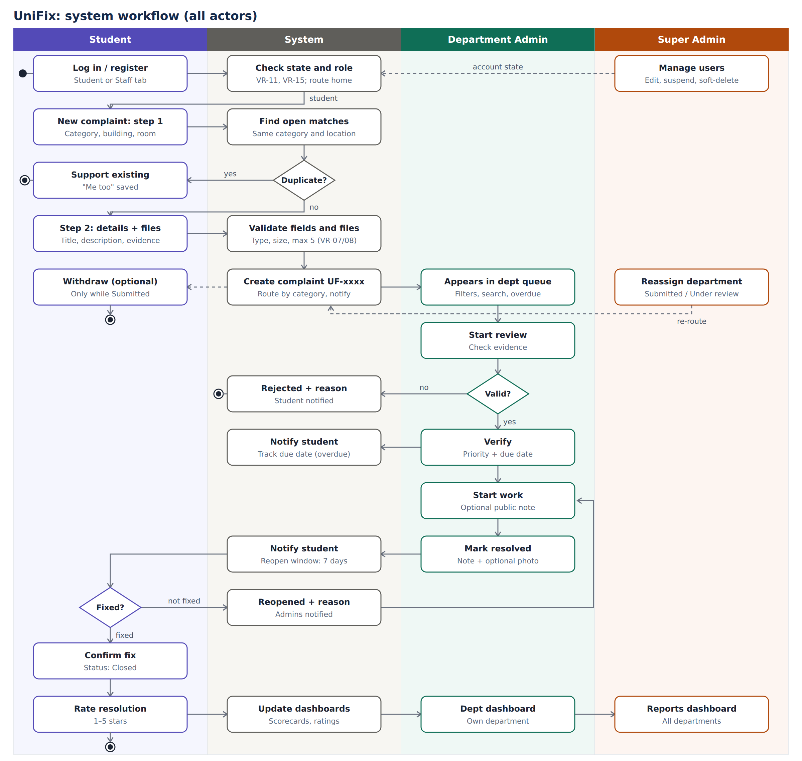
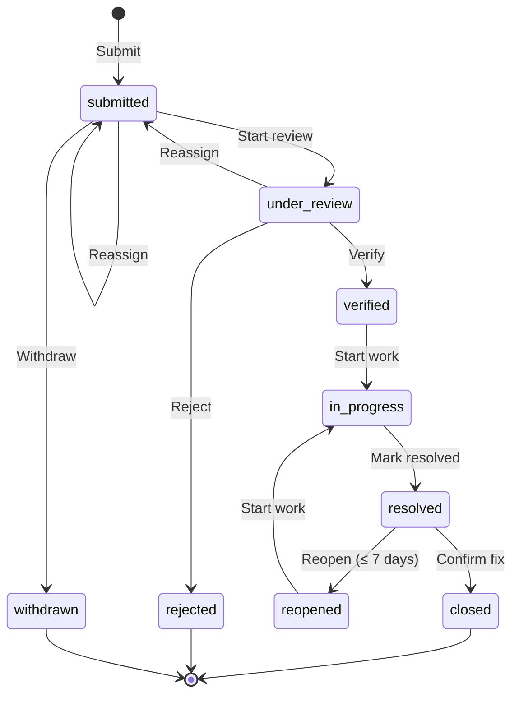

# 03. Complaint Workflow (Foundation)

## 0. System Workflow (All Actors)

*Figure: swimlane workflow across Student, System, Department Admin and Super Admin. Editable source: `diagrams/system_workflow.svg`.*

**Walkthrough**

1. **Access.** A user logs in on the Student or Staff tab; the system checks `account_state` (suspended or deleted accounts are blocked), refuses a tab that does not match the role (VR-15), and opens the home page for the user's role.
2. **Report.** The student fills the complaint form. The system validates fields and files, then searches for open complaints with the same category and location.
3. **Duplicate branch.** If one exists, the student can support it ("Me too") instead of submitting. Otherwise a complaint `UF-xxxx` is created, routed to the category's department, and that department's admins are notified.
4. **Review.** The complaint appears in the department queue. An admin starts review and decides whether it is valid: invalid complaints are rejected with a reason; valid ones are verified with a priority and due date.
5. **Work.** The admin starts work and marks the complaint resolved with a note and optional proof photo. The student is notified at each step; overdue complaints are flagged on dashboards.
6. **Confirmation.** The student confirms the fix (Closed) or reopens it within 7 days, which returns it to the admin for more work.
7. **Feedback.** After closing, the student rates the resolution; ratings and timings feed the department dashboard and the Super Admin reports.
8. **Oversight.** At any time the Super Admin can manage user accounts, reassign complaints still at Submitted or Under review, and act on any complaint as a Department Admin would.

## 1. Status Values

| Value | Label | Meaning |
|---|---|---|
| `submitted` | Submitted | Saved and routed to a department; waiting for review |
| `under_review` | Under review | An admin is checking the complaint and evidence |
| `verified` | Verified | Valid; priority and due date set |
| `rejected` | Rejected | Invalid, duplicate or out of scope (final) |
| `in_progress` | In progress | Work has started |
| `resolved` | Resolved | Fixed; waiting for the student to confirm |
| `closed` | Closed | Student confirmed the fix (final) |
| `reopened` | Reopened | Student reported the issue persists; waiting for work to restart |
| `withdrawn` | Withdrawn | Student cancelled before review (final). *Keep in view* |

Open statuses: `submitted`, `under_review`, `verified`, `in_progress`, `reopened`.

## 2. Allowed Transitions

| Action (button) | From | To | Who | Required input |
|---|---|---|---|---|
| Submit | – | `submitted` | Student | Form fields, attachments |
| Withdraw | `submitted` | `withdrawn` | Reporter | – |
| Start review | `submitted` | `under_review` | Dept Admin, Super Admin | – |
| Verify | `under_review` | `verified` | Dept Admin, Super Admin | Priority, due date |
| Reject | `under_review` | `rejected` | Dept Admin, Super Admin | Reason |
| Start work | `verified`, `reopened` | `in_progress` | Dept Admin, Super Admin | Optional note |
| Mark resolved | `in_progress` | `resolved` | Dept Admin, Super Admin | Note; optional proof photo |
| Confirm fix | `resolved` | `closed` | Reporter | – |
| Reopen | `resolved` (within 7 days) | `reopened` | Reporter | Reason |
| Reassign | `submitted`, `under_review` | `submitted` (new department) | Super Admin | New department, reason |
| Add note | any open status | (unchanged) | Admins | Note, public or internal |
| Rate | `closed` | (unchanged) | Reporter, once | 1–5 stars, optional comment |

## 3. State Diagram Source (Mermaid)

## 4. Button → Data Effect

Every action runs one model method (see `05_data_dictionary.md`), which writes the records below in a single database transaction.

| Button | `Complaint` changes | Other records created | Notified |
|---|---|---|---|
| Submit | New row: `status=submitted`, `department` from category, `tracking_id` | `Attachment` rows; `ComplaintUpdate(action=submitted)` | Dept Admins of the department |
| Me too | `updated_at=now` | `Support` row; `ComplaintUpdate(action=support)` | – |
| Withdraw | `status=withdrawn` | `ComplaintUpdate(action=withdraw)` | – |
| Start review | `status=under_review` | `ComplaintUpdate(action=start_review)` | Reporter |
| Verify | `status=verified`, `priority`, `due_date`, `verified_at=now` | `ComplaintUpdate(action=verify)` | Reporter |
| Reject | `status=rejected` | `ComplaintUpdate(action=reject, note=reason)` | Reporter |
| Start work | `status=in_progress` | `ComplaintUpdate(action=start_work)` | Reporter |
| Mark resolved | `status=resolved`, `resolved_at=now` | `ComplaintUpdate(action=resolve, note)`; optional `Attachment(kind=proof_of_fix)` | Reporter |
| Confirm fix | `status=closed`, `closed_at=now` | `ComplaintUpdate(action=close)` | Dept Admins |
| Reopen | `status=reopened`, `reopen_count+1` | `ComplaintUpdate(action=reopen, note=reason)` | Dept Admins |
| Reassign | `department=new`, `status=submitted` | `ComplaintUpdate(action=reassign, from_department, to_department, note)` | Reporter; new department's admins |
| Add note | `updated_at=now` | `ComplaintUpdate(action=note, is_internal)` | Reporter (public notes only) |
| Rate | – | `Rating` row | Dept Admins |
| Suspend user | `User.account_state=suspended`, `is_active=False` | – | – |
| Delete user (soft) | `User.account_state=deleted`, `is_active=False` | – | – |

## 5. Computed (Not Stored)

| Property | Rule |
|---|---|
| `is_overdue` | `due_date < today` and status in `verified`, `in_progress`, `reopened` (due date is only set on verify, so earlier statuses are never overdue) |
| `can_reopen` | status is `resolved` and today ≤ `resolved_at` + 7 days |
| `support_count` | number of `Support` rows for the complaint |
| `affected_count` | `support_count` + 1 (the reporter) |

## 6. Duplicate Rule

A complaint is a possible duplicate when another complaint has the **same category**, the **same building**, the **same room** (case-insensitive, spaces ignored; if either room is blank, building alone is compared) and an **open status**. Matches are shown as limited summaries (VR-01).

## 7. Due Dates After Reopening

The due date set at verification is kept when a complaint is reopened, so a reopened complaint past its due date is shown as overdue until resolved again. *(Keep in view: let admins set a new due date on Start work after a reopen.)*
