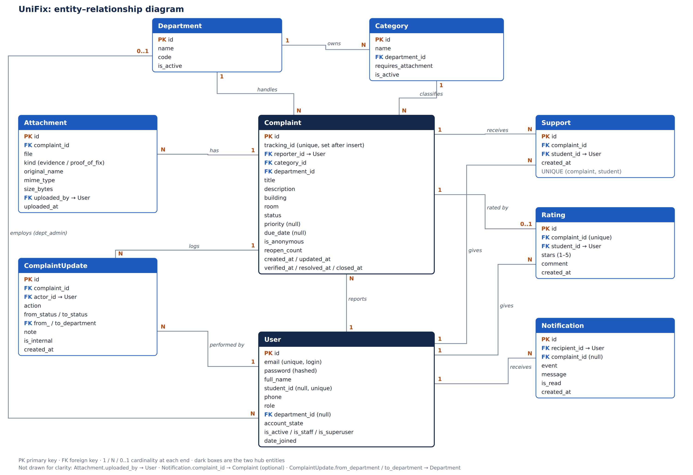
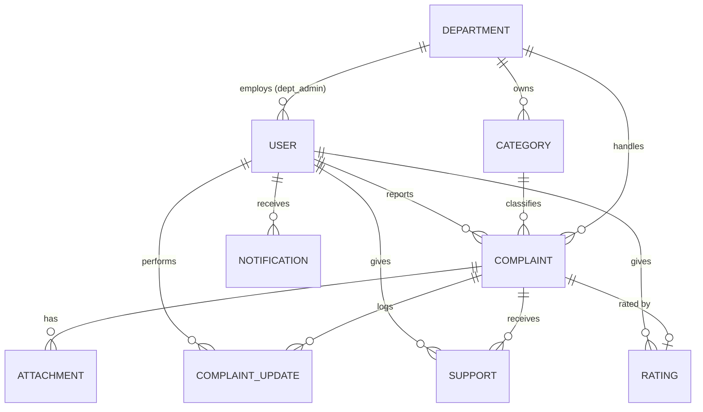

# 06. Diagram Blueprint

What each course diagram must contain, taken from files 02–05. Draw the diagrams from this list so they stay consistent with the code.

## 1. Use Case Diagram

**Actors:** Student, Department Admin, Super Admin (generalization: Super Admin → Department Admin).

| ID | Use case | Actor | Includes / extends |
|---|---|---|---|
| UC-01 | Register | Student | |
| UC-02 | Log in | All | |
| UC-03 | Submit complaint | Student | includes UC-04 Check duplicates; includes Upload attachment |
| UC-04 | Check duplicates | (system) | |
| UC-05 | Support complaint ("Me too") | Student | extends UC-03 |
| UC-06 | Track complaint | Student | |
| UC-07 | Confirm fix | Student | |
| UC-08 | Reopen complaint | Student | |
| UC-09 | Rate resolution | Student | |
| UC-10 | Withdraw complaint | Student | |
| UC-11 | Review complaint queue | Dept Admin | |
| UC-12 | Verify complaint | Dept Admin | |
| UC-13 | Reject complaint | Dept Admin | |
| UC-14 | Update progress | Dept Admin | |
| UC-15 | Resolve complaint | Dept Admin | extends: Upload proof photo |
| UC-16 | Add note | Dept Admin | |
| UC-17 | View student records | Dept Admin | |
| UC-18 | Manage users (edit, suspend, delete) | Super Admin | |
| UC-19 | Reassign complaint | Super Admin | |
| UC-20 | View reports | Super Admin | |
| UC-21 | View notifications | All | |
| UC-22 | Manage profile | All | |
| UC-23 | Search | All | Scope depends on role (C-18) |

Use case descriptions (required by the course) should be written first for UC-03, UC-12, UC-15, UC-08 and UC-18.

## 2. Class Diagram

Classes and attributes from `05_data_dictionary.md` §3. Include the methods listed there; they map one-to-one to the action buttons.

| Relationship | Multiplicity |
|---|---|
| Department — Category | 1 to many |
| Department — User (dept_admin) | 1 to many |
| Department — Complaint | 1 to many |
| Category — Complaint | 1 to many |
| User (student) — Complaint (reporter) | 1 to many |
| Complaint — Attachment | 1 to many (composition) |
| Complaint — ComplaintUpdate | 1 to many (composition) |
| Complaint — Support — User | many to many through Support |
| Complaint — Rating | 1 to 0..1 |
| User (student) — Rating | 1 to many |
| User — Notification | 1 to many |

Enumerations to draw: Role, AccountState, Status, Priority, Building, Action (includes `support`), AttachmentKind, Event.

## 3. ER Diagram

*Figure: entities, keys and cardinalities from `05_data_dictionary.md`. Editable source: `diagrams/er_diagram.svg`. Foreign keys listed in the boxes but not drawn as lines (for clarity) are named in the figure's footnote: `Attachment.uploaded_by`, `Notification.complaint`, `ComplaintUpdate.from_department` / `to_department`. The Mermaid source below is a text version of the drawn relationships.*

### ER Diagram Source (Mermaid)

## 4. Sequence Diagrams (minimum two)

1. **Submit complaint with duplicate check (UC-03, UC-05):** Student → New complaint step 1 (category, location) → `Complaint.find_duplicates()` → [found] show list → Me too: `Complaint.support()` → Support + ComplaintUpdate / Continue → step 2 (title, description, files) → form validates (VR-07, VR-08) → `Complaint.submit()` → Complaint created → Attachment saved → ComplaintUpdate → Notification to dept admins → redirect to detail.
2. **Resolve and confirm (UC-15, UC-07):** Dept Admin → Mark resolved form → `Complaint.resolve()` → Attachment (proof) → ComplaintUpdate → Notification to student → Student opens detail → Confirm fix → `Complaint.confirm()` → ComplaintUpdate → Notification to admins.
3. *(Optional)* **Verify with due date (UC-12).**

## 5. Activity Diagrams (minimum two)

1. **Complaint lifecycle:** the workflow figure (submission → closure, with duplicate, reject, reopen branches).
2. **Admin verification:** open complaint → check evidence → decision (valid?) → [no] enter reason → Reject; [yes] choose priority → pick due date → validate date → Verify.
3. *(Optional)* **User suspension** by Super Admin.

## 6. State Diagram

Complaint status: use the Mermaid source in `03_workflow.md` §3.

## 7. Architecture Diagram

Browser (Django templates + vanilla CSS/JS) → Django (urls → views → model methods) → SQLite/MySQL; media storage beside the database; Django admin panel for setup.

## 8. Object Diagram (example snapshot)

`s1: User {role=student, full_name="Rafiq Hasan"}` — reports → `c1: Complaint {tracking_id=UF-1042, status=in_progress, priority=high}` — classified by → `cat1: Category {name="Projector & AV"}` — owned by → `d1: Department {code=IT}` ← `a1: User {role=dept_admin}`; `u1: ComplaintUpdate {action=verify}` links `c1` and `a1`.
